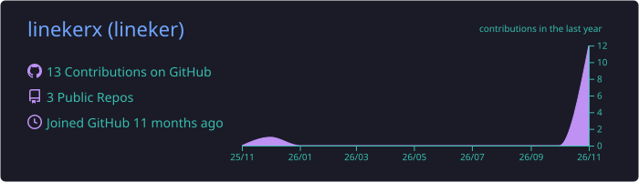
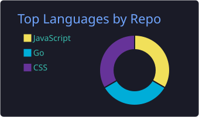
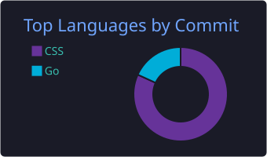
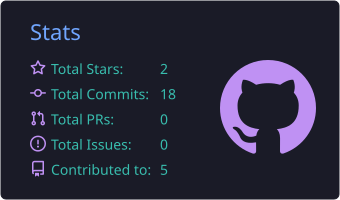

<p align="center">
  
</p>

<p align="center">
  
</p>

<p align="center">
  <a href="https://github.com/linekerx"></a>
  <a href="https://github.com/linekerx?tab=followers"></a>
  <a href="https://github.com/linekerx/deskroute"></a>
</p>

---

### `whoami`

```cpp
#include <iostream>
#include <vector>
#include <string>

struct Linekerx {
    std::string role       = "C++ enjoyer";
    std::string os         = "Arch Linux, btw";
    std::vector<std::string> loves = { "C++", "низкий уровень", "сети", "VPN", "красивые интерфейсы" };
    std::string motto      = "Если компилируется — значит, работает. Наверное.";

    void say_hi() const { std::cout << "Привет! Я " << role << " 👋\n"; }
};

int main() {
    Linekerx{}.say_hi();
    return 0; // UB не найдено. Пока.
}
```

### 🛠 Стек

**Языки**

<p>
  
  
  
  
  
  
</p>

**Инструменты**

<p>
  
  
  
  
  
  
  
</p>

**Платформы**

<p>
  
  
  
  
</p>

### 🚀 Проекты

<p align="center">
  <a href="https://github.com/linekerx/deskroute"></a>
</p>

**[DeskRoute](https://github.com/linekerx/deskroute)** — VPN-клиент для Windows, Linux и Android на ядре Xray. Подписки, как в Happ, kill switch, совместимость с zapret и интерфейс в виде схемы метро, который перекрашивается целиком. [Скачать](https://github.com/linekerx/deskroute/releases/latest)

### 📊 Статистика

<p align="center">
  
</p>
<p align="center">
  
  
  
</p>

<p align="center">
  
</p>

<picture>
  <source media="(prefers-color-scheme: dark)" srcset="https://raw.githubusercontent.com/linekerx/linekerx/output/snake.svg?v=2">
  <source media="(prefers-color-scheme: light)" srcset="https://raw.githubusercontent.com/linekerx/linekerx/output/snake-light.svg?v=2">
  
</picture>

---

<p align="center">
  <code>// TODO: переписать всё на C++26</code>
</p>
